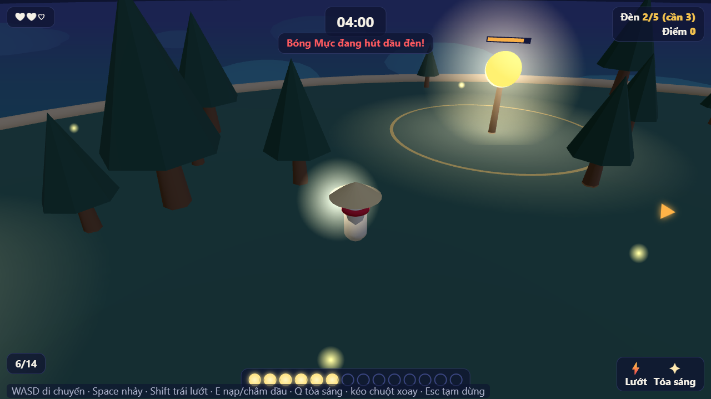
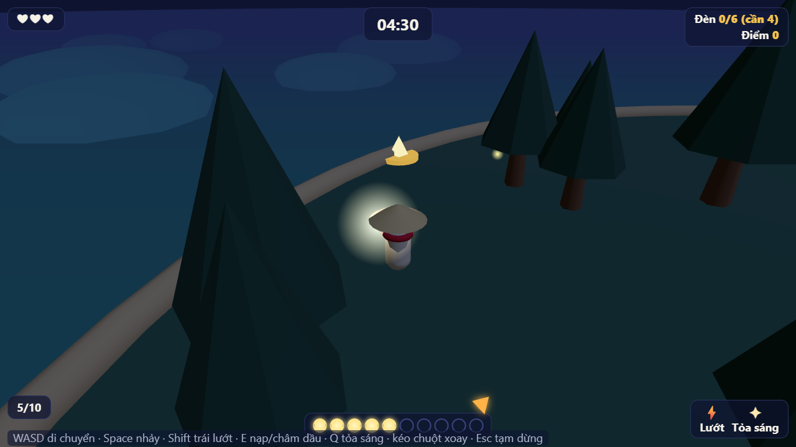
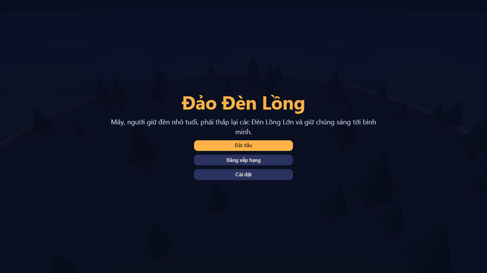

# Đảo Đèn Lồng

> **Video demo:** _(chưa có — thêm link Release `v1.0.0` hoặc `docs/demo/demo.mp4` ở đây sau khi quay)_

Game 3D góc nhìn thứ ba (Three.js + TypeScript). Bạn là **Mây**, người giữ đèn nhỏ tuổi: gom đom đóm, thắp lại các Đèn Lồng Lớn trên 3 hòn đảo (Đảo Bến, Đảo Cau, Đảo Chuông), né **Bóng Mực** và **Gió Lạc**, hoặc tỏa sáng để xua chúng. Mục tiêu mỗi Đêm: **giữ cho ít nhất 60% số đèn còn sáng tới bình minh** (3/5, 4/6, 5/7); hết Ngọn Lửa hoặc đèn sáng không đủ khi trời sáng thì thua.

| Đảo Bến | Đảo Cau | Menu |
|---|---|---|
|  |  |  |

## Yêu cầu hệ thống
Node.js 20+ (đã thử trên 24), npm, và một trình duyệt có WebGL2 (Chrome/Edge/Firefox/Safari). Chạy được trên Windows, macOS, Linux. Benchmark cần thêm Chrome/Chromium/Edge cài sẵn (đặt `CHROME_PATH` nếu ở chỗ lạ).

## Cài đặt và chạy (3 lệnh)
```bash
npm ci
npm run build      # kiểm tra kiểu + đóng gói vào dist/
npm start          # mở http://localhost:4173 (có lưu bảng xếp hạng ra đĩa)
```
Chế độ phát triển: `npm run dev` (http://localhost:5173, cũng lưu bảng xếp hạng ra `data/leaderboard.json`).

## Điều khiển (đổi được trong Cài đặt → Đổi phím)
| Phím mặc định | Việc |
|---|---|
| W A S D | Di chuyển (theo hướng camera) |
| Space | Nhảy |
| Shift trái | Lướt (14 m/s, hồi 1.5 s) |
| E | Nạp đom đóm vào đèn / châm dầu (đứng trong 2 m) |
| Q | Tỏa sáng (tốn 3 đom đóm, hồi 3 s) |
| Kéo chuột / J, L | Xoay camera |
| Esc | Tạm dừng (Tiếp tục / Chơi lại Đêm / Cài đặt / Về menu) |

## Luật chính
- Sức chứa 10 đom đóm, +2 sau mỗi lần thắp thành công (tối đa 20). Thắp đèn mới cần 10 đom đóm, thắp lại đèn đã từng sáng chỉ cần 5. Bị Bóng Mực chạm: −1 Ngọn Lửa (3 Lửa), rơi một nửa đom đóm, bất tử 1.5 s. Rơi khỏi đảo: −1 Lửa, mất hết đom đóm, hồi sinh sau 1 s.
- Đèn sáng có **dầu** (100, hao 1/s). Bấm E cạnh đèn đang sáng để châm dầu (10 dầu/đom đóm). Hết dầu thì đèn tắt.
- Đèn còn dầu ≥ 30 tạo vùng an toàn 6 m; dưới 30 thì mất, và Bóng Mực sẽ lẻn tới hút 5 dầu/giây. Tỏa Sáng trúng con đang hút được thưởng thêm.
- Gió Lạc (Đêm 2–3) cướp 3 đom đóm của người mang ≥ 5. Bùa Gió: chạy 7.2 m/s, Lướt không hồi chiêu (10 s). Đêm 3 có gió mạnh mỗi 30 s (báo trước 2 s).
- Điểm: +5/đom đóm nạp, +100 thắp lần đầu, +40 thắp lại, +5/Bóng Mực trúng Tỏa Sáng (+15 nếu đang hút dầu); bình minh (khi thắng): mỗi đèn sáng +50+⌊dầu⌋, mỗi Lửa +50. Tổng điểm = tổng các Đêm đã thắng.
- Toàn bộ con số nằm ở [`game.contract.json`](game.contract.json) (`tuning`) và game đọc đúng file đó.

## Bảng xếp hạng
Sau khi thua một Đêm hoặc qua màn Bình Minh, nhập tên (3–12 ký tự: chữ, số, `_`; chữ Việt có dấu được chấp nhận) để lưu điểm. Giữ top 10, lưu ở `data/leaderboard.json` (còn nguyên sau khi tắt/mở lại). Xuất ra file:
```bash
npx tsx scripts/serve.ts --export-leaderboard out.json    # hoặc: npm start -- --export-leaderboard out.json
```

## Dễ tiếp cận
Đổi phím cho mọi hành động (báo trùng phím, khôi phục mặc định, lưu lại) · phụ đề/chỉ báo hình ảnh (Bóng Mực xuất hiện kèm mũi tên ở mép màn hình, gió sắp thổi, đếm ngược 10 s cuối, đèn sắp hết dầu, sự kiện chính) · giảm chuyển động (tắt rung camera và chớp màn hình) · chữ ≥ 18 px ở 1280×720, tùy chọn chữ lớn ×1.25 · bảng màu dễ phân biệt cho người mù màu.

## Headless (Test Contract v1.3)
```bash
npx tsx src/headless/cli.ts --seed 1 --night 2 --ticks 600 --out out.jsonl \
  [--scenario scenario.json] [--inputs inputs.json] [--snapshot-every 10]
```
Không cần GPU/cửa sổ; `--night` 1, 2 hoặc 3. Cùng seed + scenario + inputs cho output giống hệt. File sai định dạng → mã thoát 2. Một Đêm đầy đủ (≤ 21.600 tick) chạy trong vài giây.

## Kiểm chứng, benchmark, soak
```bash
npm test                  # 78 test: luật game, 3 bản đồ, nhiên liệu/hút dầu, tất định, CLI, bảng xếp hạng, đổi phím, soak
npm run proof             # chạy CLI thật trên 29 ca, ghi docs/proof/phase-4/REPORT.md
npm run bench -- --seed 42 --duration 30 --out bench.json   # cảnh chuẩn 200 Bóng Mực + 100 đom đóm, 1280×720
npm run soak  -- --seed 7 --nights 10 --out soak.json       # 10 Đêm liên tiếp, đầu vào ngẫu nhiên theo seed
```
- `bench` mở một cửa sổ Chrome 1280×720 (không toàn màn hình, tắt vsync/giới hạn khung hình) trong ~35 s; thêm `--headless` nếu không có màn hình. Kết quả trên máy tác giả (GTX 1650): **avg 698 fps, p1-low 166 fps, p95 2.6 ms, load 1.7 s** — xem [`bench.json`](bench.json). `peak_mem_mb` là `null` vì bản web không đo được RSS của trình duyệt từ trang (có `js_heap_peak_mb` thay thế).
- `soak`: **0 lỗi, RSS 71.5 → 77.5 MB** — xem [`soak.json`](soak.json).
- Bằng chứng từng phase: [`docs/proof/phase-1`](docs/proof/phase-1/REPORT.md), [`phase-2`](docs/proof/phase-2/REPORT.md), [`phase-3`](docs/proof/phase-3/REPORT.md), [`phase-4`](docs/proof/phase-4/REPORT.md) (mỗi báo cáo khớp mã ở tag tương ứng). CI chạy build + test + proof mỗi lần push.

## Tài liệu
Spec + tiêu chí nghiệm thu: [`docs/spec/`](docs/spec) · giả định, đánh giá, nhật ký AI từng phase: [`docs/notes/`](docs/notes) · quyết định thiết kế: [`docs/adr/`](docs/adr) · thay đổi phá vỡ tương thích: [`CHANGELOG.md`](CHANGELOG.md) · retro: [`docs/retro.md`](docs/retro.md).

## Harness AI
[`AGENTS.md`](AGENTS.md) (+ `CLAUDE.md`), hook Stop chặn kết thúc khi test đỏ (`.claude/settings.json`), skill `verify-headless` (`.claude/skills/`).

## Sáng tạo của tôi
Chưa thêm ý riêng nào ngoài yêu cầu. Duy nhất: halo trên nón của Mây to dần theo số đom đóm đang mang (thuần hiển thị, không ảnh hưởng headless).

Đề bài gốc: [`docs/LAB-README.md`](docs/LAB-README.md). Nguồn asset: [`CREDITS.md`](CREDITS.md). Giấy phép: [`LICENSE`](LICENSE) (MIT).
